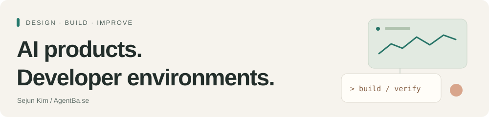

<picture>
  <source media="(prefers-color-scheme: dark)" srcset="assets/header-dark.svg">
  
</picture>

# Sejun Kim

**Co-founder & CTO at [AgentBa.se](https://agentba.se)** · [한국어](README.ko.md)

I design and build AI products and developer environments. My work connects the experience people use, the agent systems behind it, and the tools a team needs to build and improve them.

AgentBa.se CTO로서 AI 제품과 개발 환경을 설계하고 만드는 사람입니다.

[Company](https://agentba.se) · [LinkedIn](https://www.linkedin.com/in/combba) · [Writing](https://dev.to/combba) · [Contact](mailto:contact@agentba.se)

## Start here: AI products

Selected work I build with the team at [AgentBa.se](https://agentba.se). The links below lead to public code, demos and design documentation.

**[VibeCat](https://github.com/Two-Weeks-Team/vibeCat)** — A native macOS AI companion that combines screen context, voice and permission-based desktop actions.
 Explore: [demo video](https://youtu.be/j1zzfoDr7qA) · [system architecture](https://github.com/Two-Weeks-Team/vibeCat/blob/master/docs/FINAL_ARCHITECTURE.md)

**[Musely](https://github.com/Two-Weeks-Team/musely)** — An experimental shared world for personal AI agents, with identity verification, scoped permissions and persistent relationships.
 Explore: [demo video](https://youtu.be/rOo4lyCQMik) · [build timeline](https://github.com/Two-Weeks-Team/musely/blob/main/docs/BUILD_TIMELINE.md)

**[Social Seeding](https://github.com/Two-Weeks-Team/social-seeding-v2-public)** — A multi-agent influencer-campaign workflow, from creator discovery to reporting, with human approval gates. This repository is a public submission snapshot.
 Explore: [demo video](https://youtu.be/4SDvNK4cwZs) · [architecture](https://github.com/Two-Weeks-Team/social-seeding-v2-public/blob/main/docs/ARCHITECTURE.md)

## Developer environments

Tools for making AI-assisted development easier to understand, coordinate and maintain.

**[Codex Duet](https://github.com/Two-Weeks-Team/codex-duet)** — Manage selected Codex and Claude skills inside Orca, with pinned sources, local overlays and explicit file ownership.
 Explore: [installation](https://github.com/Two-Weeks-Team/codex-duet#install-in-orca) · [integration guide](https://github.com/Two-Weeks-Team/codex-duet/blob/main/docs/integrations.md)

**[Orca Concertante](https://github.com/ComBba/orca-concertante)** — A workflow for coding agents to share goals, preserve ownership and repeat build, verification and review. An independent community project for Orca.
 Explore: [quick start](https://github.com/ComBba/orca-concertante#quick-start) · [verified scope](https://github.com/ComBba/orca-concertante/blob/main/docs/validation.md)

**[OpenCode Status HUD](https://github.com/Two-Weeks-Team/opencode-status-hud)** — See model, context usage, session cost and provider utilization while working in OpenCode.
 Explore: [installation](https://github.com/Two-Weeks-Team/opencode-status-hud#install) · [npm package](https://www.npmjs.com/package/opencode-status-hud)

## Recognition

**VibeCat received an Honorable Mention at the Gemini Live Agent Challenge 2026.** Google Cloud's [official announcement](https://cloud.google.com/blog/topics/developers-practitioners/winners-and-highlights-of-the-gemini-live-agent-challenge) credits Sejun Kim and Michael Chang.

---

For product and engineering collaboration: **[contact@agentba.se](mailto:contact@agentba.se)**
